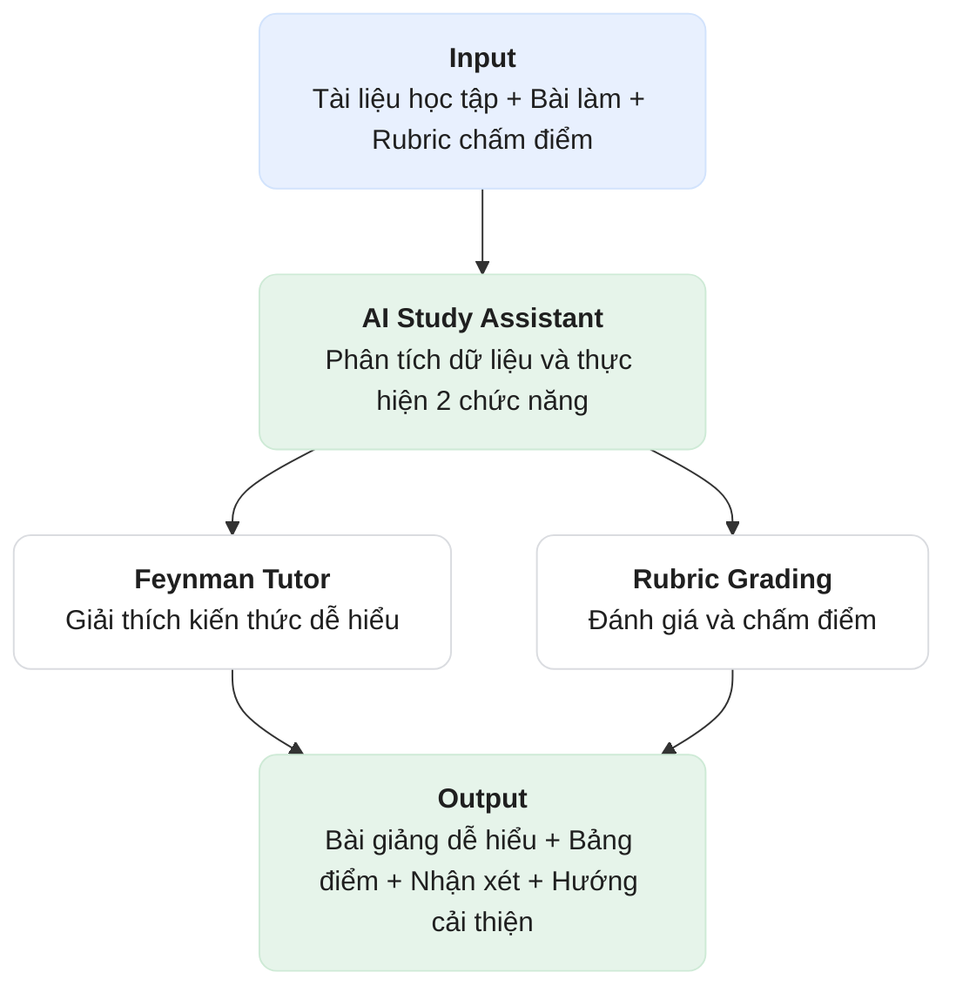

# [Vận dụng chuyên sâu] Thiết kế giải pháp Prompting ứng dụng thực tế cho Ứng dụng AI trong Học tập & Nghiên cứu
## 1. Phân tích bài toán
**Tên giải pháp:** AI Study Assistant – Trợ lý AI hỗ trợ học tập và chấm bài.

**Mục đích:**

Xây dựng một giải pháp sử dụng AI để hỗ trợ sinh viên trong quá trình học tập. Hệ thống có thể giải thích kiến thức khó hiểu theo phương pháp Feynman và đánh giá bài làm dựa trên Rubric (bảng tiêu chí chấm điểm).

Thay vì phải tự tìm tài liệu, giải thích kiến thức và kiểm tra bài làm thủ công, sinh viên có thể sử dụng AI để thực hiện các công việc này nhanh hơn.

**Quy trình hoạt động:**

## 2.
### 2.1. Xác định Input (Dữ liệu đầu vào)
Hệ thống cần các thông tin sau:
|STT	|Dữ liệu đầu vào|	Mô tả|
|---|---|---|
|1|	Chủ đề học tập	|Kiến thức sinh viên muốn tìm hiểu|
|2|	Tài liệu tham khảo	|Nội dung bài học hoặc giáo trình|
|3|	Trình độ người học|	Cơ bản, trung bình hoặc nâng cao|
|4|	Bài làm sinh viên	|Nội dung cần được đánh giá|
|5	|Rubric chấm điểm	|Các tiêu chí và điểm tối đa của từng tiêu chí|
|6|	Yêu cầu bổ sung	|Những nội dung cần giải thích hoặc lưu ý|

### 2.2. Xác định Output (Kết quả đầu ra)
AI cần trả về 2 nhóm kết quả:

**Nhóm 1: Kết quả Feynman Tutor**
- Giải thích khái niệm bằng ngôn ngữ đơn giản.
- Đưa ra ví dụ thực tế dễ hiểu.
- Đặt câu hỏi để kiểm tra mức độ hiểu bài.
- Chỉ ra những phần người học chưa hiểu rõ.

**Nhóm 2: Kết quả Rubric Grading**
- Bảng điểm theo từng tiêu chí.
- Điểm tổng kết.
- Nhận xét ưu điểm và hạn chế.
- Đề xuất cách cải thiện bài làm.
### 2.3. Xử lý các trường hợp dữ liệu lỗi
|Trường hợp	|Cách xử lý|
|---|---|
|Không có chủ đề học tập	|Yêu cầu người dùng bổ sung chủ đề|
|Không có tài liệu|	Thông báo AI chưa có nguồn để đối chiếu|
|Bài làm bị trống	|Không thực hiện chấm điểm|
|Rubric bị thiếu tiêu chí	|Yêu cầu bổ sung trước khi chấm|
|Tổng điểm Rubric không hợp lệ	|Thông báo và yêu cầu kiểm tra lại|
|Bài làm không liên quan	|Cảnh báo nội dung không phù hợp với chủ đề|
|Dữ liệu mâu thuẫn	|Chỉ ra phần mâu thuẫn và yêu cầu xác nhận|
## 3. Prompt hoàn chỉnh
---
C – Context (Bối cảnh)

Bạn là một trợ lý AI hỗ trợ học tập và nghiên cứu dành cho sinh viên. Hệ thống có nhiệm vụ giúp người học hiểu kiến thức tốt hơn và tự đánh giá chất lượng bài làm.

Người dùng sẽ cung cấp chủ đề học tập, tài liệu tham khảo, bài làm và bảng tiêu chí chấm điểm (Rubric).

R – Request (Yêu cầu)

Thực hiện 2 nhiệm vụ:

Sử dụng phương pháp Feynman để giải thích kiến thức khó hiểu thành nội dung đơn giản, dễ tiếp thu.

Sử dụng Rubric để đánh giá bài làm của sinh viên theo từng tiêu chí và tính điểm tổng kết.

E – Explanation (Giải thích)

Đối với Feynman Tutor:

Giải thích kiến thức bằng ngôn ngữ đơn giản như đang hướng dẫn người mới bắt đầu.

Chia nội dung thành các ý nhỏ.

Sử dụng ví dụ thực tế để minh họa.

Đặt 2 câu hỏi để kiểm tra mức độ hiểu bài.

Nếu có phần kiến thức chưa rõ, hãy giải thích lại bằng cách khác.

Đối với Rubric Grading:

Đọc kỹ từng tiêu chí trong Rubric.

Đánh giá bài làm theo đúng các tiêu chí được cung cấp.

Giải thích lý do cho từng mức điểm.

Không tự ý thêm tiêu chí hoặc thay đổi thang điểm.

Tính tổng điểm dựa trên điểm từng tiêu chí.

A – Action (Hành động)

Thực hiện lần lượt các bước:

Bước 1: Kiểm tra dữ liệu đầu vào.

Bước 2: Nếu dữ liệu đầy đủ, tiến hành giải thích kiến thức bằng phương pháp Feynman.

Bước 3: Đặt câu hỏi kiểm tra mức độ hiểu bài.

Bước 4: Đối chiếu bài làm với từng tiêu chí trong Rubric.

Bước 5: Lập bảng điểm và đưa ra nhận xét.

Bước 6: Đề xuất những nội dung sinh viên cần cải thiện.

T – Tone (Giọng điệu)

Sử dụng tiếng Việt tự nhiên, dễ hiểu.

Giải thích ngắn gọn, không sử dụng quá nhiều thuật ngữ chuyên ngành.

Nhận xét khách quan, mang tính xây dựng.

Không sử dụng lời lẽ gây áp lực hoặc chê bai người học.

E – Extras (Yêu cầu bổ sung)

Nếu thiếu chủ đề, tài liệu, bài làm hoặc Rubric thì phải thông báo rõ dữ liệu còn thiếu.

Không tự tạo dữ liệu để thay thế thông tin người dùng chưa cung cấp.

Nếu bài làm bị trống thì không chấm điểm.

Nếu Rubric có tiêu chí trùng lặp, thiếu điểm tối đa hoặc tổng điểm không hợp lệ thì phải cảnh báo.

Nếu thông tin trong tài liệu mâu thuẫn, phải chỉ rõ vị trí mâu thuẫn.

Không tự suy đoán nội dung mà không có căn cứ.

Nếu dữ liệu không đủ để đánh giá một tiêu chí, ghi rõ "Chưa đủ dữ liệu để đánh giá".

Điểm tổng kết phải được tính chính xác và không vượt quá thang điểm quy định.

DỮ LIỆU ĐẦU VÀO

1. Chủ đề học tập: [Nhập chủ đề]

2. Tài liệu tham khảo: [Nhập nội dung tài liệu]

3. Trình độ người học: [Cơ bản/Trung bình/Nâng cao]

4. Bài làm sinh viên: [Nhập nội dung bài làm]

5. Rubric chấm điểm:
[Nhập các tiêu chí và điểm tối đa]

ĐỊNH DẠNG ĐẦU RA

PHẦN 1: FEYNMAN TUTOR

Giải thích khái niệm.

Ví dụ thực tế.

Những ý quan trọng cần ghi nhớ.

Hai câu hỏi kiểm tra kiến thức.

---
## 4. Chạy thử Prompt
