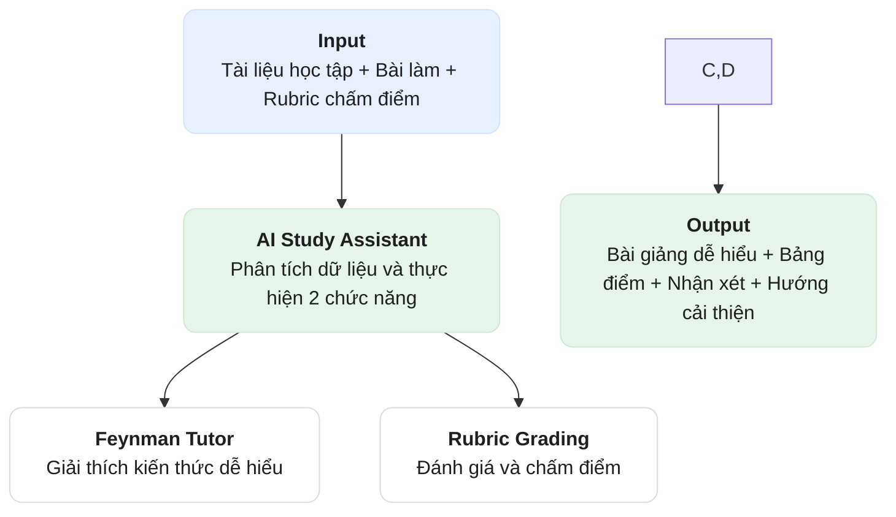

# [Vận dụng chuyên sâu] Thiết kế giải pháp Prompting ứng dụng thực tế cho Ứng dụng AI trong Học tập & Nghiên cứu
## 1. Phân tích bài toán
**Tên giải pháp:** AI Study Assistant – Trợ lý AI hỗ trợ học tập và chấm bài.

**Mục đích:**

Xây dựng một giải pháp sử dụng AI để hỗ trợ sinh viên trong quá trình học tập. Hệ thống có thể giải thích kiến thức khó hiểu theo phương pháp Feynman và đánh giá bài làm dựa trên Rubric (bảng tiêu chí chấm điểm).

Thay vì phải tự tìm tài liệu, giải thích kiến thức và kiểm tra bài làm thủ công, sinh viên có thể sử dụng AI để thực hiện các công việc này nhanh hơn.

**Quy trình hoạt động:**

